# Class Activity 1 — System Calls in Practice

- **Student Name:** Sok Makara
- **Student ID:** e20230987
- **Date:** 2026-11-04

---

## Warm-Up: Hello System Call

Screenshot of running `hello_syscall.c` on Linux:

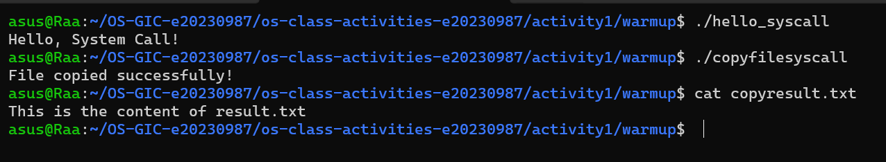

Screenshot of running `copyfilesyscall.c` on Linux:

Note: in the example code the byte counts were 19 and 25, but the strings are 20 and 26 bytes (the `\n` counts as one byte). I changed them to 20 and 26 so the newline is printed.

---

## Task 1: File Creator & Reader

### Part A — File Creator

**Describe your implementation:** The library version uses `fopen`, `fprintf`, `fclose` and `printf`. In my system call version I use `open()`, `write()` and `close()`, and I print the confirmation with `write(1, ...)`. I use `strlen()` to get the length of each string because `write()` needs a byte count. Both versions give the same terminal output and the same `output.txt`.

**Version A — Library Functions (`file_creator_lib.c`):**

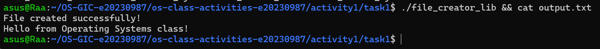

**Version B — POSIX System Calls (`file_creator_sys.c`):**

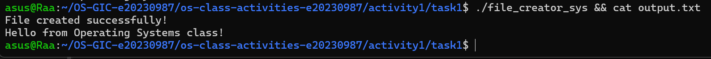

**Questions:**

1. **What flags did you pass to `open()`? What does each flag mean?**

   > I used `O_WRONLY | O_CREAT | O_TRUNC`. `O_WRONLY` opens the file for writing only. `O_CREAT` creates the file if it does not exist. `O_TRUNC` erases the old content if the file already exists. They are combined with the `|` (bitwise OR) operator.

2. **What is `0644`? What does each digit represent?**

   > It is the permission mode in octal, used when the file is created. The leading `0` means octal. The next three digits are for the owner, the group and others. `6` = read + write (4+2) for the owner, `4` = read only for the group, `4` = read only for others. So the file is `rw-r--r--`.

3. **What does `fopen("output.txt", "w")` do internally that you had to do manually?**

   > `fopen` calls `open()` with the right flags (strace showed `O_WRONLY|O_CREAT|O_TRUNC` and mode 0666, which the umask reduces), allocates a `FILE` structure with a memory buffer, and keeps the file descriptor in it. `fprintf` then formats text into that buffer and `fclose` flushes it with `write()` and calls `close()`. With system calls I do these steps myself: choose flags and permissions, give the length, write and close.

### Part B — File Reader & Display

**Describe your implementation:** My version opens `output.txt` with `open(O_RDONLY)`, reads up to 256 bytes at a time with `read()` in a loop, sends each chunk to the terminal with `write(1, buffer, bytesRead)`, then closes the file. The output is identical to the library version.

**Version A — Library Functions (`file_reader_lib.c`):**

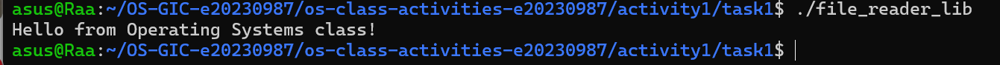

**Version B — POSIX System Calls (`file_reader_sys.c`):**

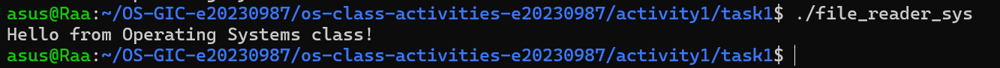

**Questions:**

1. **What does `read()` return? How is this different from `fgets()`?**

   > `read()` returns the number of bytes actually read, `0` at end of file, and `-1` on error. It gives raw bytes and does not care about lines or a null terminator. `fgets()` is a library function that reads one line, adds `'\0'` at the end, and returns a pointer to the buffer (or `NULL` at EOF or error).

2. **Why do you need a loop when using `read()`? When does it stop?**

   > `read()` may return fewer bytes than the file contains (my buffer is only 256 bytes), so I must call it again and again until all data is read. The loop stops when `read()` returns `0` (end of file), or a negative value on error. The strace output shows this: the last `read(3, "", 256) = 0`.

---

## Task 2: Directory Listing & File Info

**Describe your implementation:** I kept `opendir()`, `readdir()` and `stat()`, and replaced every `printf()` with `snprintf()` to format a line into a buffer, followed by `write(1, buffer, len)`. The listing is the same as the library version.

### Version A — Library Functions (`dir_list_lib.c`)

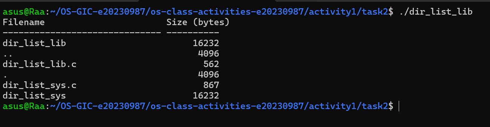

### Version B — System Calls (`dir_list_sys.c`)

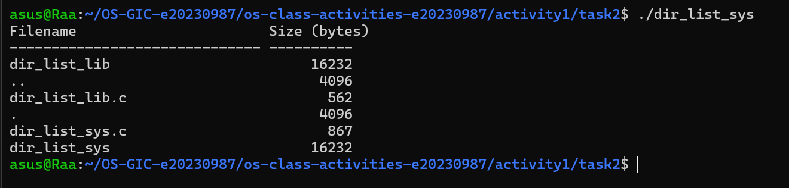

### Questions

1. **What struct does `readdir()` return? What fields does it contain?**

   > It returns a pointer to `struct dirent`. Main fields: `d_ino` (inode number), `d_off` (offset to the next entry), `d_reclen` (record length), `d_type` (file type) and `d_name` (the file name). It returns `NULL` when there are no more entries.

2. **What information does `stat()` provide beyond file size?**

   > `struct stat` also has the file type and permissions (`st_mode`), inode number (`st_ino`), device (`st_dev`), number of hard links (`st_nlink`), owner and group (`st_uid`, `st_gid`), block size and number of blocks, and the last access, modification and status-change times.

3. **Why can't you `write()` a number directly — why do you need `snprintf()` first?**

   > `write()` only sends raw bytes from memory. A number like `562` is stored as a binary integer, not as the characters `'5'`, `'6'`, `'2'`, so the terminal would show garbage. `snprintf()` converts the number to text characters (and does the padding and alignment), so `write()` can send readable text.

---

## Task 3: strace Analysis

**Describe what you observed:** The library version made **38** system calls and the system call version made **34** (from `strace -c`). Most calls come from the dynamic loader starting the program, and they appear in both. The library version has extra `fstat` and `brk` calls from setting up the stdio buffer. The most surprising thing was that `fprintf` did not call `write()` immediately.

### strace Output — Library Version (File Creator)

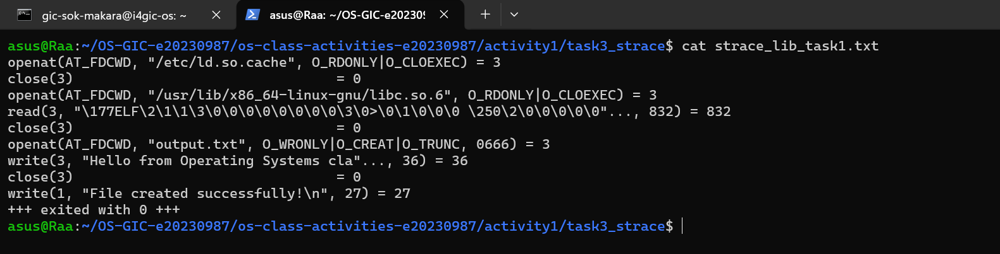

### strace Output — System Call Version (File Creator)

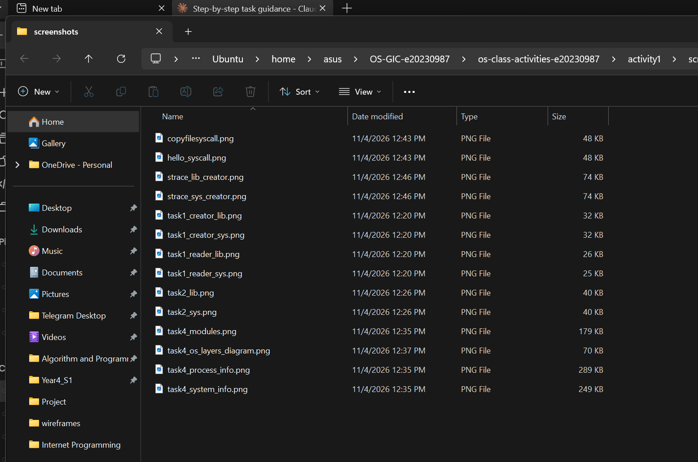

### strace Output — Library Version (File Reader)

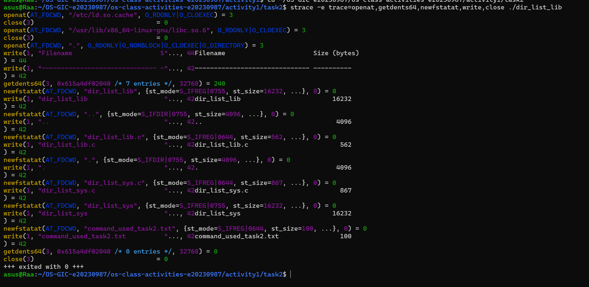

### strace Output — System Call Version (File Reader)

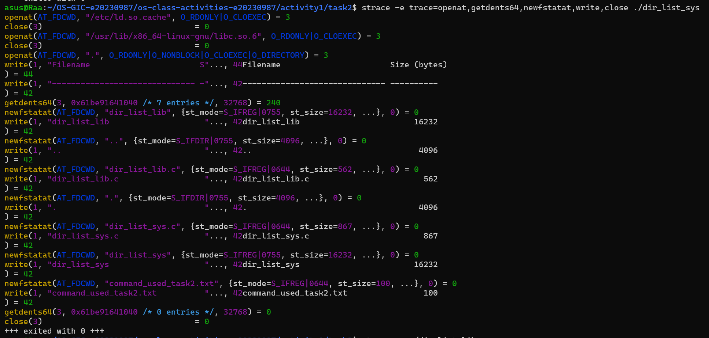

### strace -c Summary Comparison

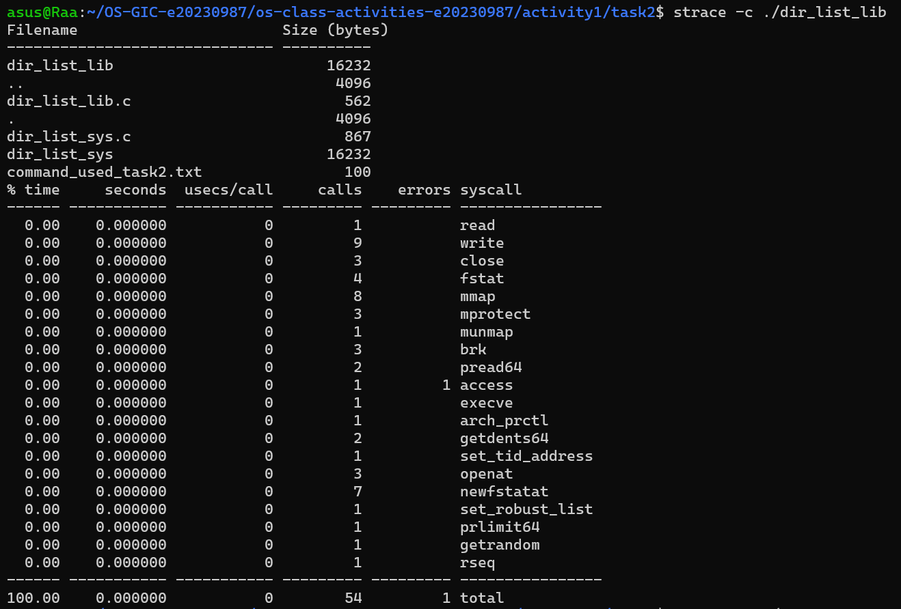
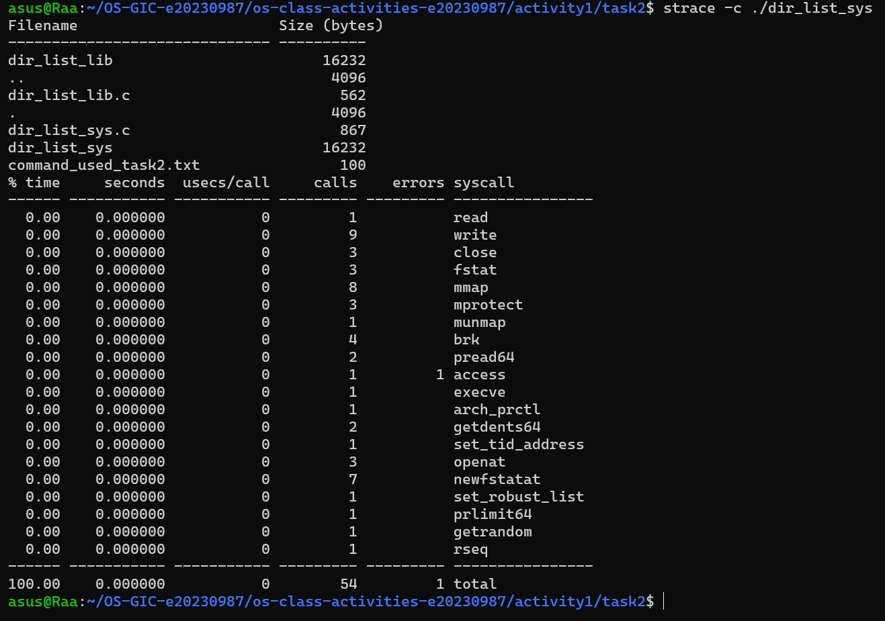

### Questions

1. **How many system calls does the library version make compared to the system call version?**

   > From `strace -c`: the library version made **38** calls and the system call version made **34** calls, so the library version made 4 more.

2. **What extra system calls appear in the library version? What do they do?**

   > The library version has 2 extra `fstat` calls (4 vs 2) and 2 extra `brk` calls (3 vs 1). `fstat` checks what stdout is (terminal or file) so stdio can choose line or full buffering. `brk` grows the heap so `malloc` can allocate the `FILE` buffer. Both versions also have loader calls such as `execve`, `mmap`, `mprotect`, `pread64`, `access` and `openat` of `libc.so.6`, because both programs are dynamically linked.

3. **How many `write()` calls does `fprintf()` actually produce?**

   > Only **one** `write()` to `output.txt` (`write(3, "Hello from...", 36) = 36`), and it happens when the file is closed and the buffer is flushed, not at `fprintf()`. I expected the text to be written immediately, but the library keeps it in a memory buffer to reduce slow kernel calls. The `printf` confirmation makes another single `write()` to fd 1.

4. **In your own words, what is the real difference between a library function and a system call?**

   > A system call is a direct request to the kernel, like `write()`, and it switches from user mode to kernel mode. A library function like `fprintf()` runs in user space, does extra work such as formatting and buffering, and only calls system calls when needed. So library functions are wrappers that make system calls easier to use, but only the system calls actually enter the kernel.

---

## Task 4: Exploring OS Structure

### System Information

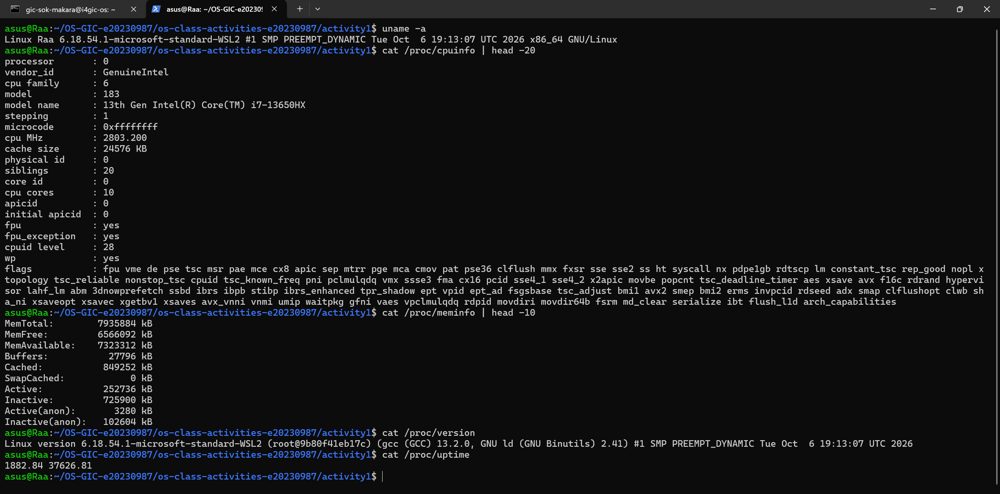

### Process Information

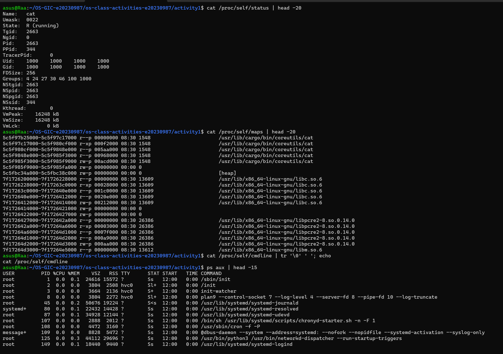

### Kernel Modules

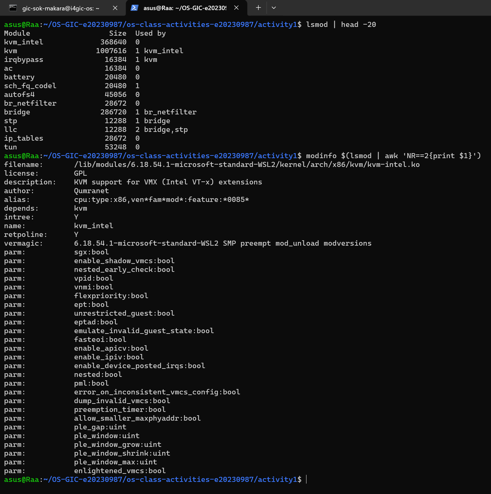

### OS Layers Diagram

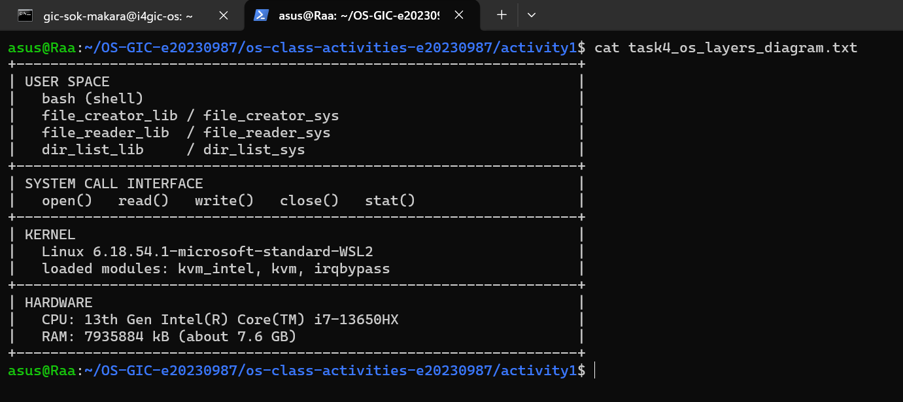

### Questions

1. **What is `/proc`? Is it a real filesystem on disk?**

   > `/proc` is a virtual (pseudo) filesystem. It is not stored on disk. The kernel creates its contents in memory when a file is read, so it shows the live state of the system: CPU, memory, processes, and so on.

2. **Monolithic kernel vs. microkernel — which type does Linux use?**

   > A monolithic kernel runs almost all OS services (scheduler, memory management, file systems, drivers) in one big program in kernel space. A microkernel keeps only the minimum in the kernel and runs the other services as user-space servers. Linux is **monolithic**, but it is modular: `lsmod` shows modules such as `kvm_intel`, `kvm` and `bridge` that are loaded into the kernel at run time.

3. **What memory regions do you see in `/proc/self/maps`?**

   > I see the program's own code and data (`/usr/lib/cargo/bin/coreutils/cat`) with different permissions (`r--p`, `r-xp`, `rw-p`), the `[heap]`, shared libraries (`libc.so.6`, `libpcre2-8.so`, `libm.so.6`), and anonymous mapped regions. Each line shows the address range, permissions, offset and the file. The stack and `[vdso]` regions are further down the list.

4. **Break down the kernel version string from `uname -a`.**

   > `Linux Raa 6.18.54.1-microsoft-standard-WSL2 #1 SMP PREEMPT_DYNAMIC Tue Oct 6 19:13:07 UTC 2026 x86_64 GNU/Linux`: `Linux` is the kernel name, `Raa` is the host name, `6.18.54.1-microsoft-standard-WSL2` is the kernel release (version 6.18.54.1, built by Microsoft for WSL2), `#1` is the build number, `SMP` means multiprocessor support, `PREEMPT_DYNAMIC` is the preemption mode, the date is the build time, `x86_64` is the architecture and `GNU/Linux` is the operating system.

5. **How does `/proc` show that the OS is an intermediary between programs and hardware?**

   > A program like `cat` cannot read CPU or memory hardware directly. It uses system calls (`open`, `read`) on files in `/proc`, and the kernel collects the data from the hardware and its own tables and returns it. So the kernel sits between the program and the hardware, controls the access, and gives a simple file interface.

---

## Reflection

I learned that library functions like `printf()` and `fopen()` are wrappers around system calls. With `strace` I could see the hidden work they do, such as buffer setup, and that stdio buffering delays the real `write()` until the file is closed. The most surprising part was that one `fprintf` does not mean one `write()`. Writing the system call versions also showed me how much the library normally does for me: formatting numbers, calculating string lengths and handling buffers.
