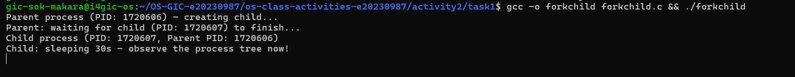
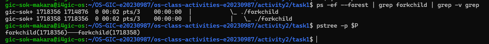
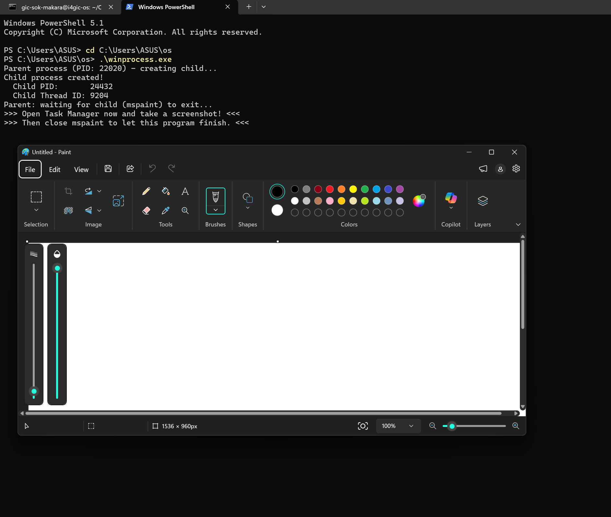
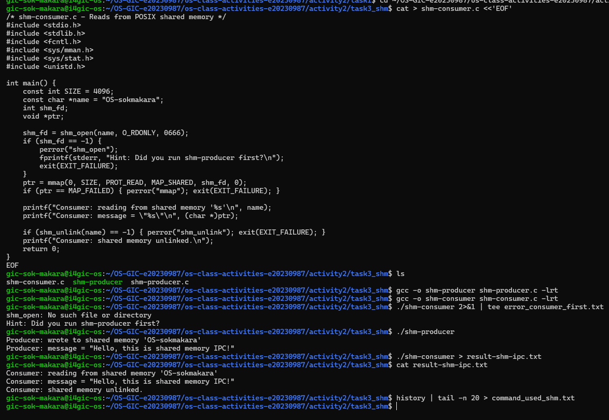

# Class Activity 2 — Processes & Inter-Process Communication

- **Student Name:** Sok Makara
- **Student ID:** e20230987
- **Date:** 9 November 2026

---

## Task 1: Process Creation on Linux (fork + exec)

### Compilation & Execution



### Process Tree



### Output

```
Parent process (PID: 1718356) - creating child...
Child process (PID: 1718358, Parent PID: 1718356)
Child: sleeping 30s - observe the process tree now!
Child: now executing 'ls -la'...
total 40
drwxrwxr-x 2 gic-sok-makara gic-sok-makara  4096 Nov  9 00:02 .
drwxrwxr-x 7 gic-sok-makara gic-sok-makara  4096 Nov  8 23:56 ..
-rw-rw-r-- 1 gic-sok-makara gic-sok-makara   612 Nov  8 23:57 command_used_forkchild.txt
-rwxrwxr-x 1 gic-sok-makara gic-sok-makara 16480 Nov  8 23:59 forkchild
-rw-rw-r-- 1 gic-sok-makara gic-sok-makara  1037 Nov  8 23:59 forkchild.c
-rw-rw-r-- 1 gic-sok-makara gic-sok-makara   185 Nov  9 00:02 result_forkchild.txt
Parent: waiting for child (PID: 1718358) to finish...
Parent: child exited with status 0
Parent: done.
```

### Questions

1. **What does `fork()` return to the parent? What does it return to the child?**

   > It returns the child's PID (a positive number) to the parent, and 0 to the child. It returns -1 if it fails.

2. **What happens if you remove the `waitpid()` call? Why might the output look different?**

   > The parent would not wait. It could print "done" and exit before the child finishes, so the output order changes. The child would become an orphan and be adopted by systemd. If the child ended first without being waited for, it would be a zombie until the parent exits.

3. **What does `execlp()` do? Why don't we see "execlp failed" when it succeeds?**

   > `execlp()` replaces the current process image with a new program (`ls -la`), searching `PATH` for it. The PID stays the same. When it succeeds it never returns, because the old code no longer exists. So the `perror` line after it only runs if exec fails.

4. **Draw the process tree for your program (parent → child). Include PIDs from your output.**

   > ```
   > bash (PID 1714876)
   >  └── forkchild (parent, PID 1718356)
   >       └── forkchild (child, PID 1718358, PPID 1718356)
   > ```

5. **Which command did you use to view the process tree (`ps --forest`, `pstree`, or `htop`)? What information does each column show?**

   > I used `ps -ef --forest` and `pstree -p`. In `ps -ef`: UID = owner, PID = process ID, PPID = parent's PID, C = CPU use, STIME = start time, TTY = terminal, TIME = CPU time used, CMD = command (indented with `\_` to show it is a child). The child's PPID (1718356) matches the parent's PID.

---
## Task 2: Process Creation on Windows

### Compilation & Execution



### Task Manager Screenshots


### Questions

1. **What is the key difference between how Linux creates a process (`fork` + `exec`) and how Windows does it (`CreateProcess`)?**

   > Linux uses two steps: `fork()` copies the current process, then `exec()` loads a new program. Windows does both in one call: `CreateProcess()` makes a new process and loads the program directly, with no copy of the parent.

2. **What does `WaitForSingleObject()` do? What is its Linux equivalent?**

   > It blocks the calling process until the given handle (here the child process) is signaled, meaning the child has exited. The Linux equivalent is `wait()` / `waitpid()`.

3. **Why do we need to call `CloseHandle()` at the end? What happens if we don't?**

   > Handles are kernel resources. `CloseHandle()` releases them. If we don't, the handles leak until the program exits.

4. **In Task Manager, what was the PID of your parent program and the PID of mspaint? Do they match your program's output?**

   > Parent winprocess.exe PID = 13540, mspaint.exe PID = 17224. Yes, they match the PIDs printed by my program, and mspaint's Parent PID equals my program's PID.

5. **Compare the Processes tab (tree view) and the Details tab (PID/PPID columns). Which view makes it easier to understand the parent-child relationship? Why?**

   > The Processes tab shows the hierarchy visually and is quicker to read. The Details tab gives exact PID and Parent PID numbers, so it is better for proving the relationship.

---
## Task 3: Shared Memory IPC

### Compilation & Execution



### Output

```
Consumer: reading from shared memory 'OS-sokmakara'
Consumer: message = "Hello, this is shared memory IPC!"
Consumer: shared memory unlinked.
```

### Questions

1. **What does `shm_open()` do? How is it different from `open()`?**

   > It creates or opens a named POSIX shared memory object and returns a file descriptor. `open()` opens a regular file on disk by path. A shared memory object lives in memory (under `/dev/shm`) and is meant to be mapped by several processes.

2. **What does `mmap()` do? Why is shared memory faster than other IPC methods?**

   > `mmap()` maps the shared memory object into the process's address space so it can be used through a pointer. It is faster because both processes access the same memory directly, with no copying through the kernel on every transfer.

3. **Why must the shared memory name match between producer and consumer?**

   > The name is how the OS finds the object. With a different name, the consumer would open a different or non-existent object and not see the producer's data.

4. **What does `shm_unlink()` do? What would happen if the consumer didn't call it?**

   > It removes the shared memory name so the object is deleted once no process has it mapped. Without it, the object stays in `/dev/shm` after the programs exit, using memory until reboot or manual removal.

5. **If the consumer runs before the producer, what happens? Try it and describe the error.**

   > `shm_open()` fails, because only the producer creates the object with `O_CREAT`. The output was:

```
shm_open: No such file or directory
Hint: Did you run shm-producer first?
```

---

