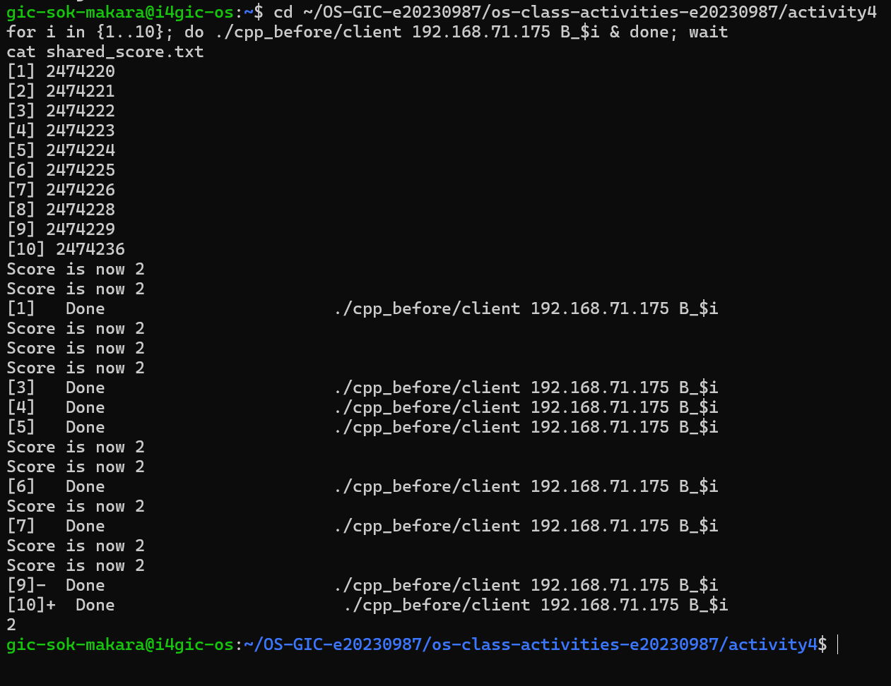
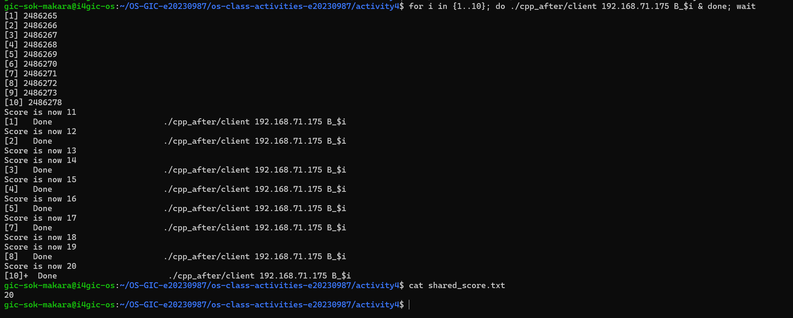
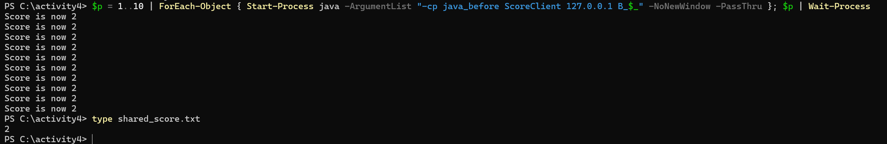
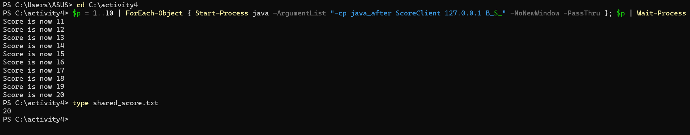

# Class Activity 4 — Shared File API

- **Student Name:** SOK MAKARA
- **Student ID:** e20230987
- **Partner Name:** Partner Full Name
- **Partner Student ID:** eXXXXXXXX
- **Server Machine Owner:** SOK MAKARA
- **Server IP Address:** 192.168.71.175 (C++ tasks); 127.0.0.1 (Java tasks, run on my Windows PC)

---

## Task 1: C++ Before Mutex

- Expected score after 20 total client requests: 20
- Actual score: 2
- What happened: Every server thread read the same old value from the file, slept 200 ms, then wrote old value + 1. The updates overwrote each other, so most increments were lost. This is a race condition.

---

## Task 2: C++ After Mutex

- Expected score after 20 total client requests: 20
- Actual score: 20
- What changed after adding mutex: `std::lock_guard<std::mutex>` lets only one thread do the read-increment-write at a time, so no update is lost.

---

## Task 3: Java Before Synchronized

- Expected score after 20 total client requests: 20
- Actual score: 2
- What happened: Same race condition as in C++. Many threads read the same value before any of them wrote, so increments were lost.

---

## Task 4: Java After Synchronized

- Expected score after 20 total client requests: 20
- Actual score: 20
- What changed after adding synchronized: `synchronized` on `updateScore` lets only one thread run it at a time, so every update is apsed -i 's/Partner Full Name/Partner Full Name/; s/eXXXXXXXX/eXXXXXXXX/' README.md- Note: I ran this task on port 9022 instead of 9012, because port 9012 was already used by another program (ArmourySocketServer.exe). The server and client were both changed to 9022. Tasks 3 and 4 were run on my Windows PC (127.0.0.1) because Java was not installed on the Linux server.

---

## Questions

1. **Why should clients send requests to the server instead of writing the file directly?**
   Only one program (the server) touches the file, so access is controlled in one place. Clients cannot overwrite each other's changes, and the server can add synchronization once for everyone.

2. **Why does the server still have a race condition before mutex or synchronized?**
   The server creates one thread per client, so many threads run `update_score` at the same time. Each thread reads the file, adds 1 and writes it back. Without protection, threads read the same old value and overwrite each other's results.

3. **In the C++ fixed version, what does `std::lock_guard<std::mutex>` protect?**
   It protects the critical section in `update_score`: reading the file, incrementing the score and writing the file. It locks when the function starts and unlocks automatically when the function ends, so only one thread is inside at a time.

4. **In the Java fixed version, what does `synchronized` protect?**
   The `synchronized` keyword on the static `updateScore` method makes threads take the class lock before entering. Only one thread can read, increment and write the file at a time.

5. **Why is the final score expected to be 20 when Student A sends 10 requests and Student B sends 10 requests?**
   Each request adds exactly 1 to the score, starting from 0. 10 + 10 = 20 requests, so the final score should be 20 if no update is lost.

6. **What could happen if two separate servers update the same file at the same time?**
   A mutex or `synchronized` only works inside one program. Two separate servers do not share the lock, so they could read the same value and overwrite each other, losing updates or even corrupting the file. A shared file lock or a single server is needed.

---

## Reflection

Both C++ and Java fix the problem the same way: they make the read-modify-write section run one thread at a time. In C++ I use an explicit `std::mutex` with `std::lock_guard`, which unlocks automatically at the end of the scope. In Java I use the `synchronized` keyword on the method, which is shorter and built into the language. Without protection, my tests lost almost all updates (score 2 instead of 20), and with protection the score was exactly 20. This activity taught me that shared resources must be protected whenever several threads read and write them, and that the protection must cover the whole read-modify-write sequence, not just one part of it.
