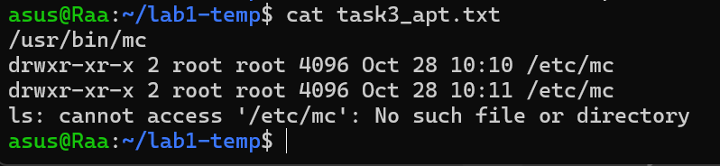
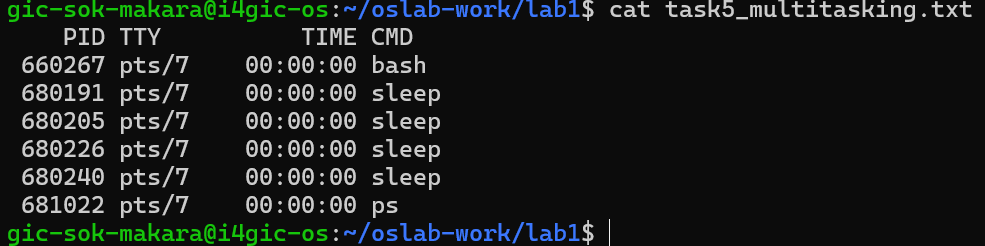
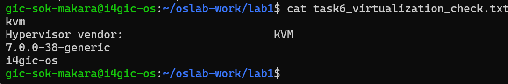

cd ~/os-gic-e20230987/os-lab-e20230987/lab1
cat > README.md << 'EOF'
# Lab 1 Report: Introduction to Operating Systems

Name: Sok Makara
Student ID: e20230987

## Task 1: Which system is this?
- Kernel version: ____ (from `uname -a`)
- Ubuntu version: ____ (from `lsb_release -a`)
- The kernel controls the hardware. Ubuntu (the distribution) is the kernel plus many other programs.

## Task 2: Files and folders
My values: file1 = panda, file2 = bridge.
Final list in the folder: panda.txt and bridge_renamed.txt.
What I learned: ____

## Task 3: Install, remove and purge (mc)
- After install: `which mc` gave /usr/bin/mc, and /etc/mc existed.
- After remove: /etc/mc still existed, so the settings were kept.
- After purge: /etc/mc gave "No such file or directory", so the settings were deleted.
- Difference: remove deletes the program but keeps the settings. Purge deletes the program and the settings.

## Task 4: Program or process?
- Before: ____
- During: ____
- After: ____
- The program is a file on the disk at ____. The process is ____.

## Task 5: Multitasking
I started 4 sleep processes in the background. `ps` showed ____.

## Task 6: Is this a virtual machine?
- First line said: ____ (`systemd-detect-virt`)
- This means: ____

EOF
cat README.md
